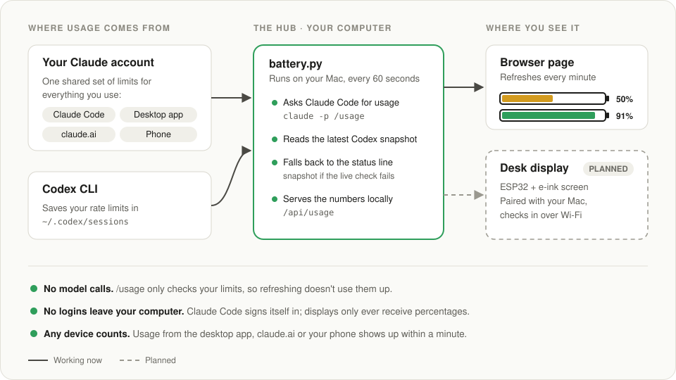

# Usage Battery

A battery meter for your AI usage limits. Instead of digging through settings pages, Usage Battery shows how much of your Claude and ChatGPT/Codex allowance is left as a set of batteries, in your browser or on a small screen on your desk. It uses data your tools already hand over, so there are no API keys to paste, no logins to share, and no numbers to type in.

- **Claude**: your 5-hour session limit and weekly limit, with the time until each one recharges.
- **ChatGPT / Codex**: your 5-hour and weekly Codex limits.
- A pixel-art look: each battery is 10 power blocks, one per 10% left, and they're green above 50%, yellow down to 20%, and red below that.
- It refreshes every minute on its own, and picks up usage from any device: Claude Code, the desktop app, claude.ai and your phone.



## What's in this repo

```
hub/                    runs on your computer; gathers your usage (always needed)
  battery.py              the hub: checks usage every minute and serves it
  battery.html            the browser page
  statusline.py           optional Claude Code status line (fallback data source)
displays/               pick the screen you have
  whisplay/               Raspberry Pi + PiSugar Whisplay HAT (1.69" screen, button, LED)
  idotmatrix/             iDotMatrix 32x32 LED pixel panel over Bluetooth
docs/                   diagrams
```

## 1. Start the hub (on your computer)

Requires Python 3 (no extra packages) and [Claude Code](https://claude.com/claude-code) signed in with a Claude Pro or Max plan.

```bash
git clone https://github.com/onetrickollie/usage-battery.git
cd usage-battery
python3 hub/battery.py
```

Open http://127.0.0.1:8765 to see your batteries in the browser. Leave the terminal window open; press Ctrl+C to stop. To try it without real data, run `python3 hub/battery.py --demo`.

**Run it in the background (macOS, recommended):**

```bash
./hub/macos/install.sh
```

The hub then starts when you log in, restarts if it stops, and keeps your Mac awake while it's plugged in (on battery the Mac sleeps normally). It runs with `--lan` so displays can reach it; use `--local-only` for this Mac only. `--status` shows whether it's running and where the log is, and `--uninstall` removes it.

**Using a separate display?** Start the hub with `--lan` instead, so devices on your Wi-Fi can reach it:

```bash
python3 hub/battery.py --lan
```

It prints the address and a passcode for your display. Other devices must send the passcode; your own computer doesn't need it. The passcode is saved in `~/.usage-battery/lan_passcode`.

## 2. Pick a display

| Display | What you get | Setup |
|---|---|---|
| **Browser** | Full page with every battery, on the computer running the hub | Nothing extra: open http://127.0.0.1:8765 |
| **Whisplay HAT** on a Raspberry Pi | 1.69" screen, button to cycle services, LED shows battery level, starts at boot | [displays/whisplay](displays/whisplay/README.md) |
| **iDotMatrix LED panel** (32×32, e.g. Reylax) | Glowing pixel batteries that cycle Claude and Codex, over Bluetooth from the hub's Mac | [displays/idotmatrix](displays/idotmatrix/README.md) |

More displays (such as e-ink panels) can be added as new folders under `displays/`. Each one only reads `/api/display` from the hub; [displays/README.md](displays/README.md) explains how to build one.

## How it works

- **Claude**: once a minute, the hub runs Claude Code's built-in `/usage` command in non-interactive mode and reads the percentages it prints. This only checks usage; it doesn't send a message to the model, so it doesn't use up your limit (each check takes about a second). Because limits belong to your account, the numbers include usage from every device.
- **Fallback**: if the live check fails, the hub uses the last numbers `statusline.py` saved when Claude Code replied, if you've set it up (see below).
- **Codex**: each time you run the Codex CLI, it saves your rate limits in `~/.codex/sessions`. The hub reads the newest snapshot.
- **Displays** ask the hub for `/api/display` every minute: a small JSON with percent left, recharge times and a level (`ok`, `low`, `critical`) for each battery.
- **Time left**: the hub keeps the last few hours of readings and estimates when a limit will run out at your current pace ("empty in ~1h 40m"), shown only when that happens before the limit resets.
- **Memory**: the last reading and recent history are saved to `~/.usage-battery/hub-state.json`, so a restarted hub shows numbers right away. Displays say how old the numbers are ("DATA 25M OLD", "OFFLINE 25M AGO") and refill a battery when its reset time passes, even while the hub is off.
- **Privacy**: the hub never reads your logins. Claude Code handles its own sign-in, the same way as when you use it yourself. Displays only ever receive percentages.

### Optional: Claude Code status line

`hub/statusline.py` shows your remaining limits at the bottom of Claude Code in Terminal, and saves them as a fallback for the hub. Add this to `~/.claude/settings.json`, changing the path to where you put this folder:

```json
"statusLine": {
  "type": "command",
  "command": "python3 ~/Projects/usage-battery/hub/statusline.py"
}
```

## Limitations

- **Needs Claude Code installed and signed in with a Pro or Max plan**, on the computer running the hub. You don't have to use Claude Code, just have it signed in. People who don't have Claude Code can't use this yet. Anthropic doesn't offer outside apps a supported way to read usage, and its terms don't allow third-party tools to use Claude plan logins.
- **The hub's computer has to be on and awake** for fresh numbers. The background service keeps a plugged-in Mac awake; if it's off or asleep, displays keep the last numbers and show how old they are.
- **Relies on the text `/usage` prints.** If a Claude Code update changes that wording, the live check stops recognizing it and the hub falls back to the status line snapshot (or shows an error) until the parser is updated.
- **Whole-percent precision.** Claude Code reports whole percentages, so a single short message may not move the number.
- **Codex numbers are only as fresh as your last Codex run.** A window whose reset time has passed is shown as full.
- **No ChatGPT web or OpenAI API usage.** ChatGPT doesn't offer outside tools a way to read your remaining usage, and OpenAI's API usage reports need an organization admin key.

## Roadmap

1. **More displays**, such as an e-ink panel (for example an ESP32 board like the Adafruit MagTag or LilyGo T5).
2. **Cloud relay**, so displays work away from home Wi-Fi and keep the last numbers while the computer is off.
3. **Cross-platform hub.** Background services for Windows and Linux, and reliable support for both alongside macOS.
4. **Support for more people.** Cover users who don't use Claude Code once Anthropic offers an official way to read usage. There's an open request: [anthropics/claude-code#13585](https://github.com/anthropics/claude-code/issues/13585).
