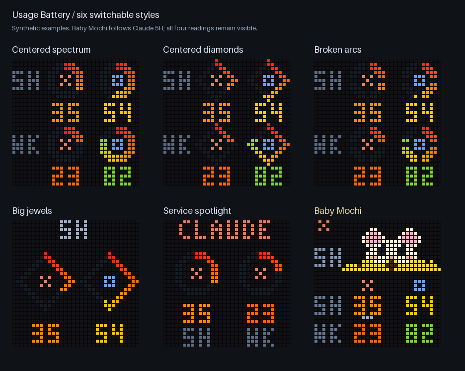

# iDotMatrix LED panel

Displays Claude and Codex usage on a 32×32 iDotMatrix LED panel (sold under brands such as Reylax), over Bluetooth from the computer running the hub.

## Six switchable styles



[Browse all styles and animated previews](styles/README.md). Each style lives in its own folder with drawing code, metadata, documentation, and preview images.

**Baby Mochi** is the mascot style: the cute mouse and yellow cheese represent Claude's **5-hour** limit. The lower table keeps **both Claude and Codex logos and all four percentages** visible. The mouse takes a brief bite when Claude 5H decreases, then the panel returns to a still image. Codex and weekly-only changes update their numbers without animating the mascot.

Other styles are centered spectrum rings, centered diamonds, broken arcs, big jewels, and service spotlight. Paged styles stay on a fixed page unless rotation is explicitly enabled.

## Install (macOS)

Requires the hub running on this Mac (`hub/macos/install.sh`) and the panel nearby, with the phone app disconnected:

```bash
./displays/idotmatrix/install.sh
./displays/idotmatrix/style.sh baby-mochi
```

The installer creates `displays/idotmatrix/.venv` with `idotmatrix`, `bleak`, and `pillow`, then installs/restarts the background service. On first use it discovers the panel (Bluetooth name starts with `IDM-`) and remembers its address in `~/.usage-battery/idotmatrix.json`.

**Upgrading an already-running bridge?** Run the installer once to load the new code. After that, changing styles only updates the selector file; there is no reinstall or reconnect per switch. Without a selection, the original battery layout remains the default for compatibility.

## Change styles

```bash
./displays/idotmatrix/style.sh                         # available styles + current choice
./displays/idotmatrix/style.sh baby-mochi
./displays/idotmatrix/style.sh spectrum
./displays/idotmatrix/style.sh diamonds
./displays/idotmatrix/style.sh broken-arcs
./displays/idotmatrix/style.sh big-jewels --page week
./displays/idotmatrix/style.sh service-spotlight --page codex
./displays/idotmatrix/style.sh legacy                  # rollback to original batteries
```

The bridge re-reads `~/.usage-battery/idotmatrix-style.json` at its next refresh, normally within 60 seconds. `--rotate --seconds 3` enables optional rotation for `big-jewels` or `service-spotlight`. See the [style guide](styles/README.md) for details.

## How it works

```text
hub /api/display → bridge.py → selected renderer → 32×32 PNG/GIF → Bluetooth panel
```

The bridge fetches the hub once a minute, uploads changed pictures, and refreshes the panel every ten minutes. It keeps the Bluetooth connection open. A new connection causes the panel's own connection screen to appear, so reconnecting on every refresh is avoided.

For Baby Mochi, a fresh 5H decrease produces a 0.84-second animation; an increase/reset refills the cheese in 0.60 seconds. The bridge then uploads a still PNG, rather than leaving an eating GIF looping. The first reading after startup/style selection is a still image. No new style blinks for low limits.

Old service readings dim after 180 seconds. A top-right yellow dot indicates stale data; red indicates an unreachable hub. A missing value is `?`. Codex at zero with credits displays `CR` in red. The last readings are retained while offline, with no unconfirmed refill.

The original `legacy` layout retains its clock, batteries, credits coin, and low-limit blinking. `--claude` and `--all` keep their original full-screen layouts and ignore the style selector.

## Controls and maintenance

| Action | Command |
|---|---|
| Check the service | `./displays/idotmatrix/install.sh --status` |
| Free the panel for the phone app | `./displays/idotmatrix/install.sh --pause` |
| Resume | `./displays/idotmatrix/install.sh --resume` |
| Restart/load updated code | `./displays/idotmatrix/install.sh` |
| Remove the service | `./displays/idotmatrix/install.sh --uninstall` |
| Inspect logs | `tail -f ~/Library/Logs/usage-battery-idotmatrix.log` |
| One-shot upload with selected style | `displays/idotmatrix/.venv/bin/python displays/idotmatrix/bridge.py --once` |
| Temporary process-only style | `displays/idotmatrix/.venv/bin/python displays/idotmatrix/bridge.py --style spectrum --once` |

Pause the background service before a manual Bluetooth test, then resume it afterward. Some sandboxed shells make bleak abort; test the panel from a normal terminal or through the background service.

The panel's power/mode buttons are not exposed over Bluetooth and cannot select these styles. The mode button can switch to a built-in screen; the bridge reasserts its picture on the next changed update or ten-minute refresh. A browser style picker may come later.

## Preview and verify without hardware

```bash
./displays/idotmatrix/style.sh baby-mochi --preview --output /tmp/mochi-preview
displays/idotmatrix/.venv/bin/python displays/idotmatrix/preview_styles.py
displays/idotmatrix/.venv/bin/python -m unittest discover -s displays/idotmatrix/tests -v
```

These commands use invented data, never accounts or Bluetooth. The generated previews live under `styles/`.

## Troubleshooting

- **Selector changes have no effect:** restart once to load this bridge version; check that it is not running with legacy `--claude`/`--all`, or a fixed `--style` override.
- **Bad selector JSON:** the running bridge retains its last valid choice and logs the issue. Re-select a style with `style.sh` to repair it.
- **Panel unavailable:** ensure it is on, nearby, and disconnected from the phone app. The bridge retries failures.
- **Animation does not settle correctly:** the bridge always sends a still picture after an animation, but panel firmware timing can vary. Switch to `spectrum` or `legacy` while investigating.

Uses the community [python3-idotmatrix-library](https://github.com/derkalle4/python3-idotmatrix-library). Tested with a Reylax 32×32 panel (Bluetooth name `IDM-…`) on macOS. The library is archived, so a panel firmware update could break it.
