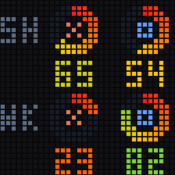
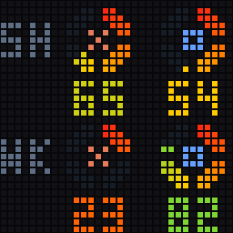
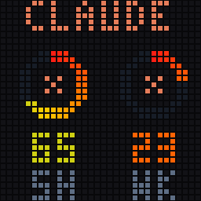
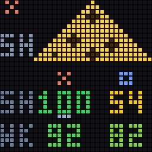

# Display styles

Six self-contained rendering styles for the 32×32 panel. Each folder contains its renderer, metadata, a native 32×32 PNG, a larger preview, an animated demo, and a short README.


Animated demos (click one for its page):

<table>
  <tr><td align="center"><a href="spectrum/README.md"></a><br><b>Centered spectrum</b><br><code>spectrum</code></td><td align="center"><a href="diamonds/README.md"></a><br><b>Centered diamonds</b><br><code>diamonds</code></td><td align="center"><a href="broken-arcs/README.md"></a><br><b>Broken arcs</b><br><code>broken-arcs</code></td></tr>
  <tr><td align="center"><a href="big-jewels/README.md"></a><br><b>Big jewels</b><br><code>big-jewels</code></td><td align="center"><a href="service-spotlight/README.md"></a><br><b>Service spotlight</b><br><code>service-spotlight</code></td><td align="center"><a href="baby-mochi/README.md"></a><br><b>Baby Mochi</b><br><code>baby-mochi</code></td></tr>
</table>

| Style ID | Preview and documentation | What stays visible |
|---|---|---|
| `spectrum` | [Centered spectrum](spectrum/README.md) | Both services, both limits |
| `diamonds` | [Centered diamonds](diamonds/README.md) | Both services, both limits |
| `broken-arcs` | [Broken arcs](broken-arcs/README.md) | Both services, both limits |
| `big-jewels` | [Big jewels](big-jewels/README.md) | Both services, one selected time window |
| `service-spotlight` | [Service spotlight](service-spotlight/README.md) | Both limits, one selected service |
| `baby-mochi` | [Baby Mochi](baby-mochi/README.md) | All four numbers; cheese represents Claude 5H only |

Previews use invented data, not an account snapshot. GIFs loop for documentation. In actual use, new styles are still by default. Only the two paged styles support optional continuous rotation; Mochi's short transition is always followed by a still PNG.

## Switch styles

From the repository root, after restarting the bridge once with `install.sh`:

```bash
./displays/idotmatrix/style.sh                         # list styles and current selection
./displays/idotmatrix/style.sh baby-mochi
./displays/idotmatrix/style.sh spectrum
./displays/idotmatrix/style.sh diamonds
./displays/idotmatrix/style.sh broken-arcs
./displays/idotmatrix/style.sh big-jewels --page week
./displays/idotmatrix/style.sh service-spotlight --page codex
./displays/idotmatrix/style.sh legacy                  # original batteries / rollback
```

Selection is atomic and is re-read on the next hub refresh (normally within 60 seconds). No file copying, reinstallation, or Bluetooth reconnect is needed to switch styles once this bridge version is running. `--claude` and `--all` are legacy modes and ignore the selector.

For deliberate rotation, opt in explicitly:

```bash
./displays/idotmatrix/style.sh big-jewels --rotate --seconds 3
./displays/idotmatrix/style.sh service-spotlight --rotate --seconds 3
```

Selecting a style without flags returns it to a fixed first page. The selector file is `~/.usage-battery/idotmatrix-style.json`, separate from the panel-address file. Example:

```json
{
  "style": "baby-mochi",
  "page": 0,
  "rotate": false,
  "seconds": 3.0
}
```

No selector file means `legacy`. An invalid file keeps the running bridge's last valid selection and logs an error; a fresh process falls back to `legacy`. Deleting the selector restores `legacy` at the next refresh. Style IDs come from an allowlist; the configuration cannot load arbitrary code paths.

## Preview without a panel

Requires Pillow in the display virtual environment. These commands never read accounts, contact the hub, write the live selector, or use Bluetooth:

```bash
./displays/idotmatrix/style.sh baby-mochi --preview --output /tmp/mochi-preview

displays/idotmatrix/.venv/bin/python displays/idotmatrix/preview_styles.py
# Optional: --output /tmp/all-style-previews
```

The second command regenerates the GitHub PNG/GIF files alongside these READMEs. Preview generation uses Pillow's bundled font (Pillow 10.1+); runtime renderers use the repository's pixel glyphs.

## Shared behavior

- Claude and Codex keep their assigned slots even if one service is missing.
- Percentages are centered under their logos/gauges. `100` and `CR` fit without shifting the centerline.
- `?` means unknown or missing; it is never displayed as an invented zero.
- The weekly value is the all-model weekly limit. Model-specific Opus/Sonnet entries are not substituted.
- A depleted Codex limit with available credits displays `CR` in red.
- Numbers and art for a service older than 180 seconds are dimmed to 45%.
- A reserved top-right 2×2 dot is yellow for stale data and red when the hub is unreachable. Last known numbers are retained. An offline client does not invent a refill; it waits for a confirmed hub reading.
- New styles do not blink at low/zero values. The legacy renderer retains its original warning behavior.
- No mouse animation occurs on startup, a style switch, an unchanged reading, Codex changes, weekly-only changes, or stale/offline catch-up. A known, fresh Claude-5H decrease produces a 0.84-second nibble; an increase/refill produces a 0.60-second fill.
- The display bridge stays connected and reasserts the picture every ten minutes. The panel's physical buttons do not select these styles.

## Renderer contract

Every style exports:

```python
render(snapshot, page=0, amount=None, motion="hold", tick=0) -> PIL.Image.Image
```

The image must be RGB, 32×32. `Snapshot.services` contains fixed Claude/Codex slots; each `Service.limits` tuple contains 5H/weekly percentages or `None`. Styles are pure drawing functions, with no networking, accounts, filesystem writes, clocks, or Bluetooth.

`common.py` normalizes hub data and shares pixel primitives. `runtime.py` owns settings and change detection. `StyleSession.plan()` returns frames, millisecond durations, whether rotation loops, and an optional final still frame. `bridge.py` handles delivery and explicitly uploads that still PNG after a transient animation, including a best-effort restore on animation-upload failure.

To add a style, create its folder with `render.py`, `style.json`, and README, add its ID to `STYLE_IDS` in `__init__.py`, then regenerate previews and run the tests. The standalone folders share the `styles/` support code and root pixel font; they are not independent Python installations.

```bash
displays/idotmatrix/.venv/bin/python -m unittest discover -s displays/idotmatrix/tests -v
```
