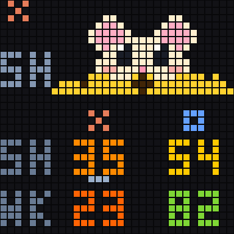

# Baby Mochi

A mouse with round pink ears, glossy eyes, rosy cheeks, tiny paws, and a little tooth. The yellow cheese hides the mouse at 100% and reveals it as **Claude’s 5-hour allowance** drops. The bottom table always shows Claude and Codex logos, both 5H readings, and both weekly readings. The fixed underline marks Claude 5H. Yellow cheese never changes hue with urgency; the numbers do.

No automatic page switching or low-limit blinking. Changed Claude 5H triggers one short animation and then a still image. Other changes update their numbers only.



## Demo


These are synthetic examples. The original-resolution image is [preview-32.png](preview-32.png).

## Select

From the repository root, with the bridge running:

```bash
./displays/idotmatrix/style.sh baby-mochi
```

## Files

- `render.py`: pure drawing function using shared style helpers.
- `style.json`: ID, description, page names, and preview filenames.
- `preview.png`, `preview-32.png`, `demo.gif`: generated, GitHub-friendly examples.

See the [style guide](../README.md) for configuration, status indicators, preview generation, the renderer contract, and rollback.
