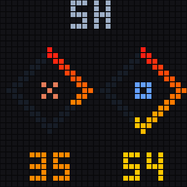
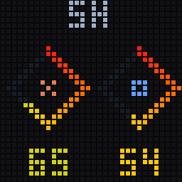

# Big jewels

Large spectrum diamonds, Claude left and Codex right. Default: a still 5H page. Use `--page week` for a still weekly page, or `--rotate` to explicitly alternate every three seconds. The demo below shows optional rotation.



## Demo



These are synthetic examples. The original-resolution image is [preview-32.png](preview-32.png).

## Select

From the repository root, with the updated bridge running:

```bash
./displays/idotmatrix/style.sh big-jewels
```

## Files

- `render.py`: pure drawing function using shared style helpers.
- `style.json`: ID, description, page names, and preview filenames.
- `preview.png`, `preview-32.png`, `demo.gif`: generated, GitHub-friendly examples.

See the [style guide](../README.md) for configuration, status indicators, preview generation, the renderer contract, and rollback.
