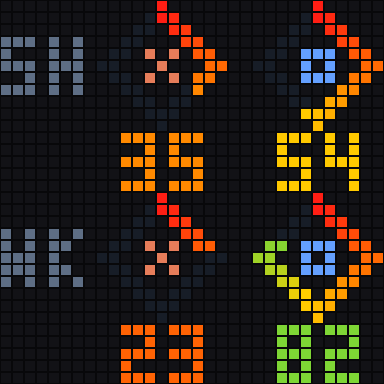
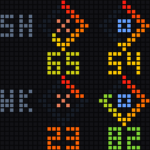

# Centered diamonds

Claude is left, Codex is right. The top row is 5H and the bottom row is WK. Each logo, gauge, and number shares an exact centerline. All four readings stay on screen without page rotation. The demo below cycles invented readings to illustrate changing usage; it does not represent automatic paging.



## Demo



These are synthetic examples. The original-resolution image is [preview-32.png](preview-32.png).

## Select

From the repository root, with the updated bridge running:

```bash
./displays/idotmatrix/style.sh diamonds
```

## Files

- `render.py`: pure drawing function using shared style helpers.
- `style.json`: ID, description, page names, and preview filenames.
- `preview.png`, `preview-32.png`, `demo.gif`: generated, GitHub-friendly examples.

See the [style guide](../README.md) for configuration, status indicators, preview generation, the renderer contract, and rollback.
